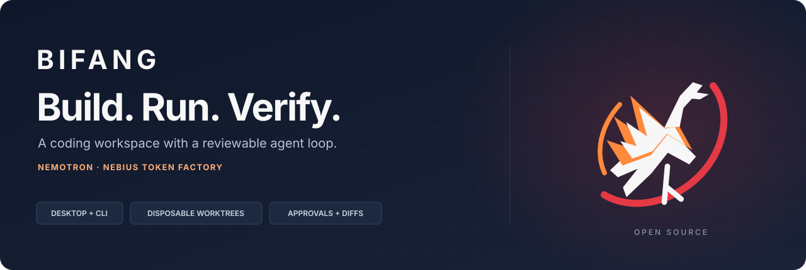
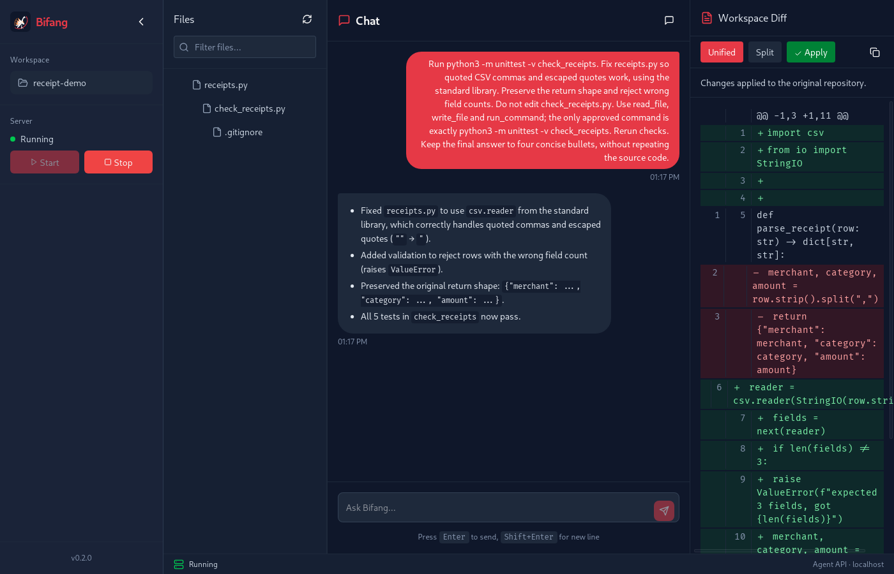
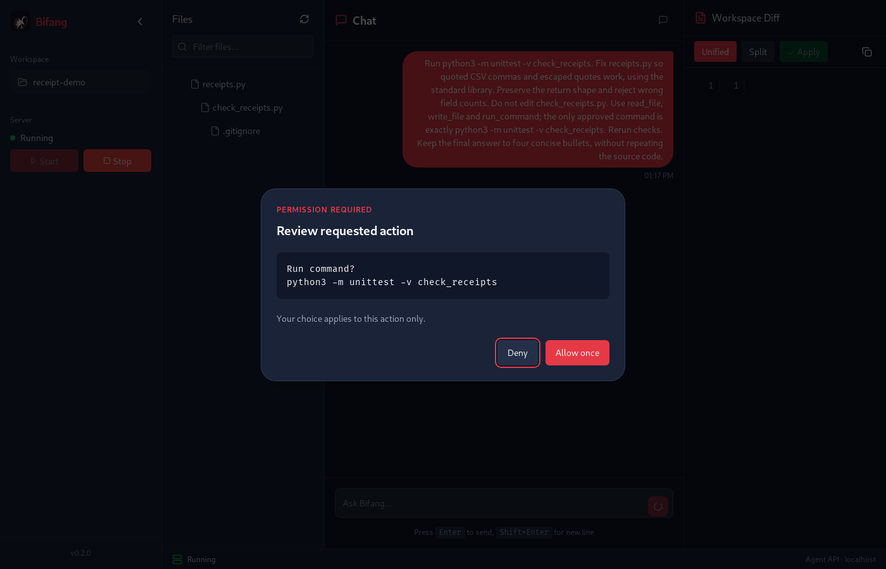
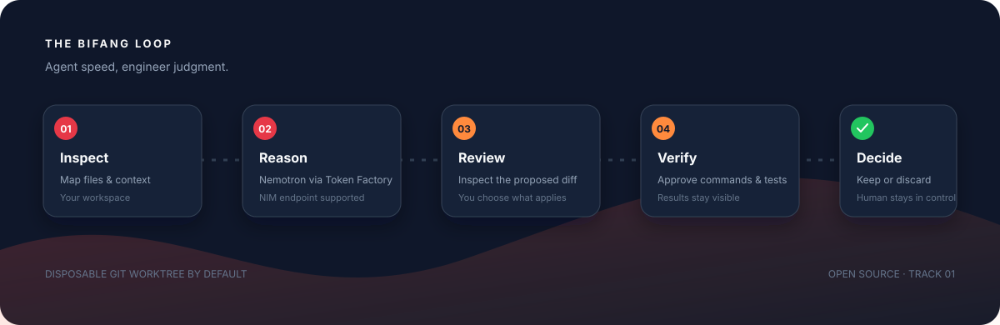

<p align="center">
  
</p>

<p align="center"><strong>Give the agent a failing test. Keep control of the change.</strong><br />Open-source desktop and terminal tools for agentic engineering.</p>

<p align="center">
  <a href="https://github.com/Protocol-X-01/bifang/blob/main/LICENSE"></a>
  
  
</p>

<p align="center"><a href="#see-the-coding-loop">See the demo</a> · <a href="#quickstart">Run Bifang</a> · <a href="docs/ARCHITECTURE.md">Architecture</a> · <a href="docs/HACKATHON_READINESS.md">Build status</a></p>

Bifang is a desktop coding IDE and terminal agent built around a practical, reviewable engineering loop. It can map a repository, propose focused edits, run approved commands and tests, and show the resulting diff before you keep or discard the work. Git repositories use a disposable worktree by default, leaving the original checkout untouched until you explicitly export or apply a patch.

| Understand | Change | Verify |
| --- | --- | --- |
| Inspect files and repository context. | Approve edits in a disposable Git worktree. | Run checks, review the diff, then apply or discard. |

> Independent open-source project for the Nebius x NVIDIA Global AI Hackathon. Not an official NVIDIA or Nebius product.

## See the coding loop

The [receipt-parser demo](docs/DEMO.md) starts with two broken CSV cases.
Nemotron Ultra fixes the parser through Bifang's tools, leaving the original
checks intact. The release-profile desktop app completed the live task,
approval dialogs, diff review, and patch application. All five original
checks passed in the source checkout afterward.



<details>
<summary><strong>Review an action before it runs</strong></summary>



Approvals are scoped to one action. The demo harness clicked these actual
controls using an exact-action allowlist; this is not a recording of human clicks.

</details>

| Verified on October 23 | Evidence |
| --- | --- |
| Live Token Factory coding task | Only `receipts.py` changed; all five checks passed after apply. |
| Runtime regression suite | 29 passing tests, including an HTTP model → tool → model exchange. |
| Linux desktop loop | Release-profile Debian package; native UI approvals, diff and apply verified. |
| NVIDIA-compatible endpoint | Configured hosted NVIDIA API returned a Nemotron Ultra completion. |

The native UI rehearsal used synthetic code, a preselected test workspace,
and automated approvals restricted to the demo's edit and test actions.
See [demo evidence](docs/DEMO_EVIDENCE.md) and
[remaining release gates](docs/HACKATHON_READINESS.md). Clean-machine
installation and the native folder chooser have not been tested.

<p align="center"></p>

## Quickstart

- Python 3.11 (the supported range is `>=3.11,<3.12`)
- Git for isolated worktrees; Bubblewrap is optional on Linux
- A Nebius Token Factory API key, or an OpenAI-compatible NVIDIA NIM endpoint
- Building the desktop app additionally requires Rust 1.90+, Node.js 20.19+,
  `uv`, and the platform's Tauri system dependencies

```bash
sudo apt update
sudo apt install -y pipx git ripgrep bubblewrap
pipx ensurepath
git clone https://github.com/Protocol-X-01/bifang.git
cd bifang
pipx install --python python3.11 .
```

Configure your provider, then open a project:

```bash
export NEBIUS_API_KEY='...'
bifang doctor
cd your-project
bifang chat
```

For development, from the cloned repository:

```bash
uv sync --locked --extra dev --extra observability
```

To run the desktop IDE in development (its build script provisions a separate
locked Python environment for the bundled service):

```bash
cd desktop
npm ci
npm run tauri:dev
```

The desktop shell requires Python 3.11, Rust 1.90+, Node.js 20.19+, and the
platform's Tauri build dependencies. Its build packages `bifang-server` as a
sidecar; users do not need Python installed to run the packaged app. See
[`desktop/README.md`](desktop/README.md) for configuration and Linux packaging.

## Why this build

The Bifang bird identity represents watchfulness and controlled fire: the
agent moves the work forward while the engineer can inspect what changed.
The engineering focus is a complete coding loop with visible evidence.

KV-cache quantization remains an experimental research thread, with its
benchmark plan in [Performance](docs/PERFORMANCE.md). It is not connected to
the serving path yet. [TensorRT compatibility notes](docs/TENSORRT_COMPATIBILITY.md)
explain the Debian-package Python constraint and the separation between the
desktop client and a model-serving environment.

The GPU-acceleration motivation is to make a coding agent feel responsive while
it understands a large codebase and runs an iterative edit/test loop. The
inspiration includes the new class of desk-side AI systems exemplified by
NVIDIA RTX Spark and DGX Spark. Bifang currently sends model inference to
Nebius Token Factory by default, with an OpenAI-compatible NIM endpoint as an
alternative; it does not yet run models locally on Spark hardware or claim
measured GPU speedups. Local inference is a potential future backend, not a
requirement for the current hackathon demo.

The long-term vision includes desktop and mobile clients. The hackathon build
focuses on making the desktop coding loop complete and demonstrable; a mobile
companion for session review and approvals can follow without turning the
deadline into two parallel IDE builds.

## Configure

```bash
export NEBIUS_API_KEY='...'
export BIFANG_DEFAULT_PROVIDER='nebius'
export BIFANG_NEBIUS_BASE_URL='https://api.tokenfactory.nebius.com/v1'
export BIFANG_NEBIUS_MODEL='nvidia/Nemotron-3-Ultra-550b-a55b'
```

For an NVIDIA NIM deployment instead:

```bash
export NVIDIA_API_KEY='...'
export BIFANG_DEFAULT_PROVIDER='nvidia'
export BIFANG_NVIDIA_BASE_URL='http://localhost:8000/v1'
export BIFANG_NVIDIA_MODEL='<model-served-by-your-NIM>'
```

For NIM, point the NVIDIA-compatible provider at the OpenAI-compatible NIM
endpoint and use the model name configured by that deployment. NGC credentials
are needed to pull licensed NVIDIA containers; they are not inference API keys.
The app does not deploy NIM or provision GPUs by itself.

Use `bifang models` to inspect the live model catalog rather than relying on a hard-coded model ID.

## Use

Try the [repeatable receipt-parser demo](docs/DEMO.md) to rehearse the
inspect → approve → edit → test → apply loop on synthetic code.

```bash
cd your-project
bifang doctor
bifang chat
```

Inside chat:

```text
Find the failing parser test, determine the root cause, make the smallest reasonable fix, and verify it.
```

Commands:

```text
/help /status /map /diff /tests /transcript /quit
```

Other CLI operations:

```bash
bifang run -- pytest -q
bifang patch > bifang.patch
bifang discard
bifang --version
```

## Safety model

- disposable Git worktree by default;
- filesystem tools confined to the Bifang workspace;
- typed model tools, validated before use;
- `observe`, `assist`, and `trusted` modes;
- approval required for mutation and execution in `assist` mode;
- destructive patterns blocked in every mode;
- environment allowlist, timeout, and output cap;
- JSONL audit transcript under `.bifang/sessions`.

Bifang is defense in depth, not a formally verified security boundary. Bubblewrap support is included for Linux command isolation, but kernel policy may disable unprivileged user namespaces. Use disposable VMs for hostile repositories.

## Development

```bash
uv run python -m compileall -q src
uv run ruff check src/bifang/workspace.py src/bifang/tracing/phoenix.py tests/test_workspace.py tests/test_config_env.py tests/test_ngc.py tests/test_phoenix_tracing.py tests/test_server_auth.py
uv run pytest -q
./scripts/build-linux.sh
```

See `docs/ARCHITECTURE.md`, `docs/SECURITY.md`, `docs/RELEASING.md`, and
`docs/DEPLOYMENT.md`. Hackathon deliverables and remaining gates are tracked in
`docs/HACKATHON_READINESS.md`.
