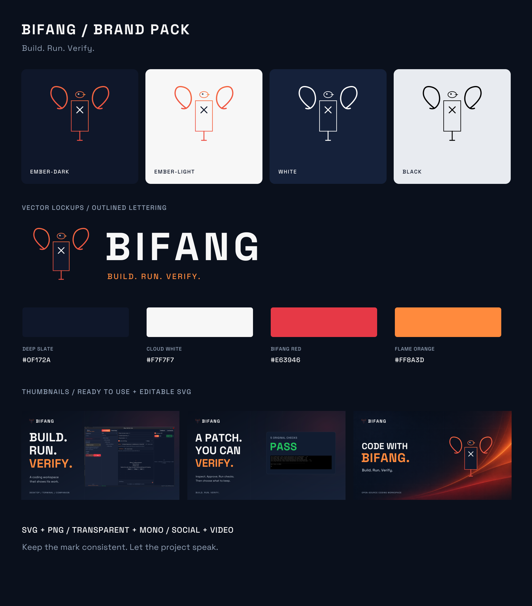
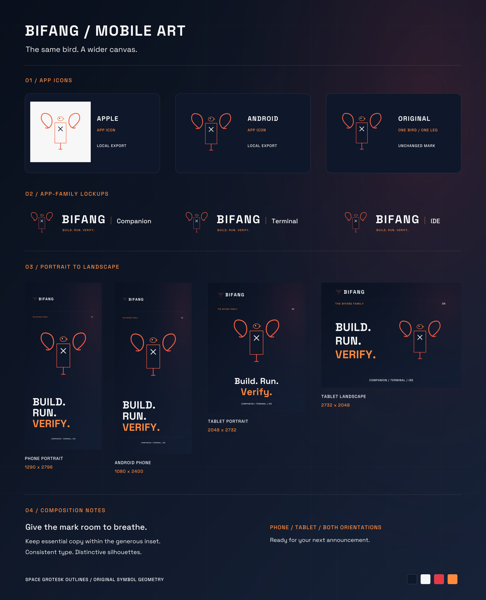

# Bifang brand assets

The ember bird, ready for your next build, announcement or demo.

[Download the complete brand pack](https://github.com/Protocol-X-01/Bifang/releases/download/brand-pack-2026-11-06/Bifang-Brand-Pack-20261106-v2.zip) · [Download checksum](https://github.com/Protocol-X-01/Bifang/releases/download/brand-pack-2026-11-06/Bifang-Brand-Pack-20261106-v2.zip.sha256) · [Browse editable assets](assets/brand-pack/)

## Choose an asset

| Use | Files |
| --- | --- |
| Logos and overlays | [Outlined SVGs](assets/brand-pack/logos/svg/) · [Transparent PNGs](assets/brand-pack/logos/png/) |
| Video thumbnails | [Coding demo](assets/brand-pack/thumbnails/youtube-coding-demo-1920.png) · [Reviewed patch](assets/brand-pack/thumbnails/youtube-reviewed-patch-1920.png) · [Brand](assets/brand-pack/thumbnails/youtube-brand-1920.png) |
| Social and channel artwork | [Social previews, banners and story covers](assets/brand-pack/social/) |
| iPhone and iPad | [Any/Dark/Tinted and explicit-size icon catalogs](assets/brand-pack/mobile/apple/) · [Integration guide](assets/brand-pack/guide/APPLE_ASSETS.md) |
| Android phones and tablets | [Adaptive/themed icons, legacy densities and Play icon](assets/brand-pack/mobile/android/) · [Integration guide](assets/brand-pack/guide/ANDROID_ASSETS.md) |
| Mobile promotions | [Phone and tablet artwork in both orientations](assets/brand-pack/promos/mobile/) |
| Companion, Terminal and IDE | [Family lockups](assets/brand-pack/logos/svg/) |
| Palette, type and spacing | [Usage guide](assets/brand-pack/guide/USAGE.md) · [Palette](assets/brand-pack/guide/palette.json) |

Download and extract the ZIP, then open `START-HERE.html` locally for the filterable catalogue. The pack contains **139 artworks**: 47 SVGs, 88 PNGs, three Android vector XML files and a multi-size favicon. Editable builders, original inputs, font licence and credits are included.

## Mobile and tablet artwork

Apple exports include 1024-pixel Any, Dark and grayscale Tinted icons plus an explicit iPhone/iPad catalog. Android resources include adaptive gradient layers, a monochrome themed layer, five legacy density sizes and a 512-pixel Play listing icon. Promotional covers include phone portrait and tablet portrait/landscape compositions.

## Export verification

Artwork dimensions, transparency, outlined lettering, icon safe areas and catalogue links passed validation. Repeated export produced identical bytes for all 139 artworks; the ZIP is reproducible and every entry matches the source files and checksum manifest. Android resources compiled and linked with Android SDK 36. Apple catalog dimensions and opacity were checked on Linux; Xcode compilation and device appearance remain part of app integration.

[Artwork checks](assets/brand-pack/VALIDATION.json) · [Native asset checks](assets/brand-pack/NATIVE-ASSET-VALIDATION.json) · [File checksums](assets/brand-pack/SHA256SUMS.txt) · [Sources and credits](assets/brand-pack/source/CREDITS.md)

Use the [project handoff checklist](assets/brand-pack/guide/PROJECT-HANDOFF-CHECKLIST.md) when extending the pack. The SVG masters keep the original single supporting leg and code glyph; the tiny favicon uses a dedicated simplified mark.
