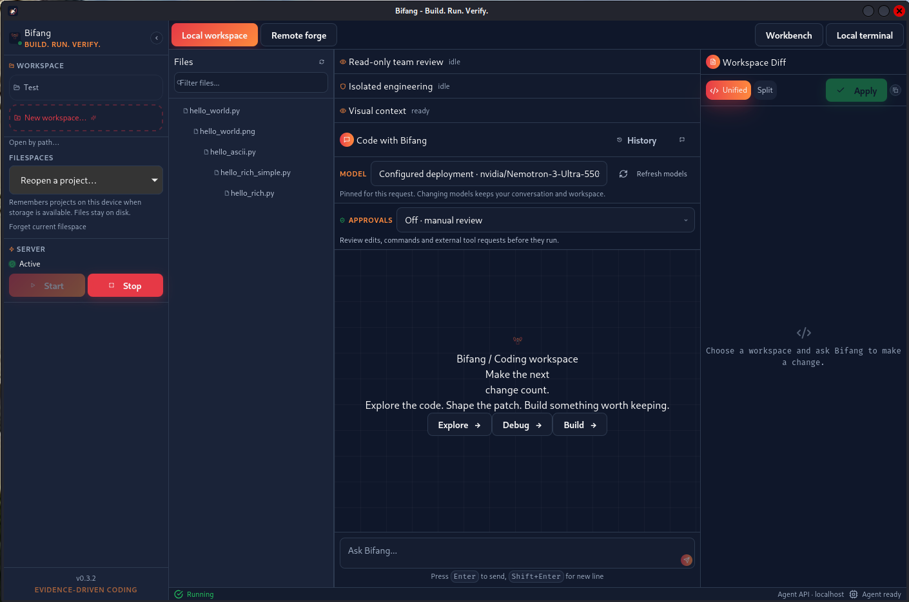
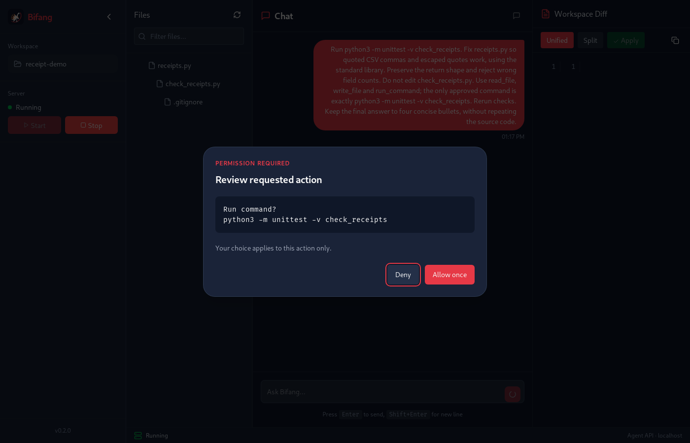

# Demo recordings and evidence

## Public narrated demo

[Watch Bifang's narrated demo](https://www.youtube.com/watch?v=gwAAJcWplf0).
The owner confirmed this is the link attached to the submitted Devpost entry.
Public playback metadata checked on November 6 reports the title
**Bifang narrated demo**, a 170-second duration, public availability, and an
October 30 upload by Protocol X. The [metadata receipt](evidence/submitted-video-20261106.json)
records the scope of that check.

## Earlier native desktop run — October 23, 2026

The observations below describe that retained recording and build.

Reproduce it with the checked-in [desktop rehearsal tool](DESKTOP_REHEARSAL.md).

[Watch/download the continuous desktop recording](assets/bifang-live-demo.mp4).
It has explanatory labels but no voiceover, staged patch, or time compression.
Approvals are automated, not human clicks. The accompanying
[run evidence](evidence/desktop-demo.json) and
[final check output](evidence/desktop-checks.txt) record the verified outcome.
This continuous recording is retained rehearsal material; the public narrated
submission video is linked above.

The release-profile Tauri Debian package was extracted and launched with its
bundled Python sidecar on a virtual Linux display. WebDriver interacted with
the actual application, using live Nebius Token Factory inference from
`nvidia/Nemotron-3-Ultra-550b-a55b`.

1. Submit the receipt-parser task in the chat input.
2. Approve only the proposed parser edit and the exact unittest command.
3. Display the assistant's response and the actual workspace diff.
4. Click Apply and confirm Apply to repository.
5. Verify the source checkout: only `receipts.py` changed, the original test
   file remained byte-identical, and all five checks passed.

The workspace path was preseeded in test storage. Approval clicks were
automated with an exact-action allowlist. The folder chooser, human usability,
clean-machine installation, and distribution portability were not tested.
The screenshots contain synthetic code, not private project files or keys.

## Other checks

- Backend regression suite: 29 passed, including an HTTP model/tool cycle.
- Frontend: TypeScript and production Vite build passed.
- Production npm dependency audit: zero reported vulnerabilities at check time.
- Separate packaged-server rehearsal: the same receipt task passed five checks.
- NVIDIA public hosted endpoint: a configured Nemotron Ultra completion
  succeeded. This is not evidence of a self-hosted NIM deployment.

## Further delivery evidence

The submission centers on the coding loop through Nebius Token Factory.
See [readiness](HACKATHON_READINESS.md) for versioned package and deployment
checks, and [release notes](RELEASING.md) for installation details.
